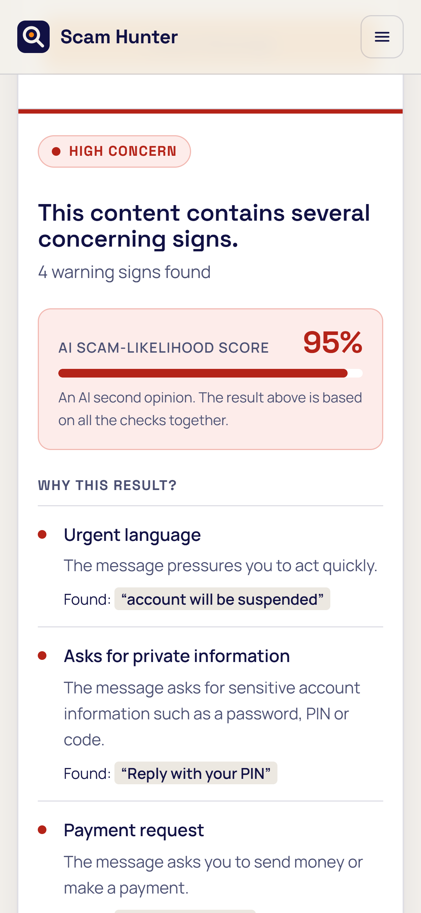

# Scam Hunter: Check Before You Act


Scam Hunter helps people in Rwanda check a suspicious **message, link or phone number** before they click,
reply, share a PIN or send money. Paste what you received and Scam Hunter tells you how concerned to be,
**why**, and what to do next. It works as a website and as an Android app that can warn you about scam calls
and SMS as they arrive.

**Live website:** [scam-hunter-y1c7.onrender.com](https://scam-hunter-y1c7.onrender.com) &nbsp;|&nbsp;
**Android app:** [Download the APK](https://github.com/honnete-1/Scam_hunter/releases/tag/v1.3.0) &nbsp;|&nbsp;
**Video demo:** [Watch the video](PASTE_VIDEO_LINK_HERE) &nbsp;|&nbsp;
**SRS document:** [Read the SRS](PASTE_SRS_LINK_HERE)

<p align="center">
  
</p>

---

## Table of contents

1. [The problem](#the-problem)
2. [Features](#features)
3. [How a check works](#how-a-check-works)
4. [Tech stack](#tech-stack)
5. [Try it without installing anything](#try-it-without-installing-anything)
6. [Run it on your own computer](#run-it-on-your-own-computer)
7. [Running the tests](#running-the-tests)
8. [Project structure](#project-structure)
9. [API overview](#api-overview)
10. [Deployment](#deployment)
11. [Limitations](#limitations)
12. [More documentation](#more-documentation)
13. [Author](#author)

---

## The problem

Scam SMS, fake mobile-money messages and scam calls trick people into sending money or sharing their PIN.
Most people have no quick way to check a message before acting on it, and once the money is sent it is
usually gone. Scam Hunter gives them a check that takes seconds and explains its answer in plain language.

## Features

| Who | What they can do |
|-----|------------------|
| **Visitor** (no account) | Check a message, link or phone number. See the result, the warning signs found and a safer next step. Browse recent Scam Alerts. |
| **Registered user** | Everything a visitor can do, plus report a scam message, link or number and follow the report's status in **My Reports**. |
| **Number owner** | Ask for their number to be removed if it was reported by mistake, with proof (for example a letter from MTN or Airtel). |
| **Moderator** | Review reports in the admin dashboard: approve them (the number or link is then flagged for everyone), reject them, or accept and decline removal requests. |
| **Android user** | All the checks on the phone, scanning a QR code, and **real-time protection**: a warning over the call screen when a known scam number calls, and a warning when a scam SMS arrives. |

**Every result is one of three concern levels.** Scam Hunter never says something is *definitely* a scam.

| Result | Meaning |
|--------|---------|
| **High Concern** | A known scam record, or 3 or more different warning signs |
| **Caution** | 1 or 2 warning signs |
| **No Known Warning Signs** | Nothing was found. This does not guarantee the content is safe. |

If a required lookup fails, the result says **Check Unavailable** instead. A failure is never shown as "safe".

**Also included:**
- Answers in the message's language (for example Kinyarwanda or French) when the AI check is set up.
- Rate limits, so one person cannot flood the checks, logins or reports.
- A "server is waking up" notice when the free hosting is slow to start.
- Privacy: checked content is never saved, and personal details are removed before anything is sent to the AI service.

## How a check works

```
You paste a message, link or number
        ↓
Input is checked and cleaned        (invalid input stops here)
        ↓
Scam-pattern rules                  urgency, PIN or code requests, payment requests, false authority...
        ↓
Approved scam records               links and numbers confirmed by moderators
        ↓
Optional online checks              AI second opinion, Google Safe Browsing, URLhaus, website age
        ↓
Result: concern level + why + a safer next step
```

The AI can only **add** a warning, never remove one, so a scam message cannot trick it into hiding what the
rules found. See [docs/technical-details.md](docs/technical-details.md) for the full design.

## Tech stack

| Part | Technology |
|------|------------|
| Backend and API | Python 3.12, Django 5.2, Django REST Framework, OpenAPI docs (drf-spectacular) |
| Database | PostgreSQL in production, SQLite for a quick local run |
| Website | React 19 + Vite |
| Mobile app | React Native with Expo (TypeScript), Android native module for call and SMS protection |
| Moderation | Django Admin |
| Hosting | Render (web service + PostgreSQL), APK on GitHub Releases |
| Testing and CI | Django tests, Vitest, Jest; GitHub Actions runs all of them on every pull request |

## Try it without installing anything

### Website
Open **[scam-hunter-y1c7.onrender.com](https://scam-hunter-y1c7.onrender.com)**.

> The free hosting plan sleeps after 15 minutes without visitors. The first page can take **up to a minute**
> to load. After that it is fast.

Paste this example on the **Check** page to see a High Concern result:

```
URGENT: Your MoMo account will be suspended today. Reply with your PIN and send 5,000 RWF to reactivate it.
```

### Android app
1. On an Android phone, open the [v1.3.0 release](https://github.com/honnete-1/Scam_hunter/releases/tag/v1.3.0)
   and tap **ScamHunter-1.3.0.apk** to download it
   ([direct download link](https://github.com/honnete-1/Scam_hunter/releases/download/v1.3.0/ScamHunter-1.3.0.apk)).
2. Open the downloaded file. When Android asks, allow **Install unknown apps** for your browser.
3. If Play Protect warns you, tap **More details**, then **Install anyway**. The app is not on the Play Store yet, so Android doesn't recognise it.
   If Android says *App blocked to protect your device* with no way to continue, follow
   [Installing it when Android blocks it](mobile/README.md#installing-it-when-android-blocks-it).
4. Open Scam Hunter. Sign up, or log in with an account you made on the website, since both use the same server.
5. To get warnings during calls and SMS, go to **Profile**, open **Real-time Protection** and allow the permissions it asks for.

## Run it on your own computer

### What you need
- [Python 3.12](https://www.python.org/downloads/)
- [Node.js 22](https://nodejs.org/) (includes npm)
- [Git](https://git-scm.com/downloads)

No API keys and no database server are needed. Without them, the project uses a local SQLite file and
skips the optional online checks.

### Step 1: Download the code

```bash
git clone https://github.com/honnete-1/Scam_hunter.git
cd Scam_hunter
```

### Step 2: Start the backend (API and admin)

**Windows**
```bash
python -m venv .venv
.venv\Scripts\activate
pip install -r requirements.txt
python manage.py migrate
python manage.py createsuperuser
python manage.py runserver
```

**macOS / Linux**
```bash
python3 -m venv .venv
source .venv/bin/activate
pip install -r requirements.txt
python manage.py migrate
python manage.py createsuperuser
python manage.py runserver
```

- `createsuperuser` makes your **moderator** account. Choose a username and password when it asks.
- If PowerShell refuses to run `activate`, use Command Prompt instead, or run
  `Set-ExecutionPolicy -Scope CurrentUser RemoteSigned` once.

Leave this terminal running. Now you can open:

| Address | What it is |
|---------|------------|
| http://127.0.0.1:8000/api/docs/ | Interactive API documentation (try every endpoint) |
| http://127.0.0.1:8000/admin/ | Moderator dashboard (log in with the superuser you created) |

### Step 3: Start the website

Open a **second** terminal in the `Scam_hunter` folder:

```bash
cd frontend
npm install
npm run dev
```

Open **http://localhost:5173**. The website sends its requests to the backend from Step 2, so keep both running.

### Step 4 (optional): Run the mobile app from source

The easiest way to see the app is the APK above. To run it from the code with Expo Go, follow
[mobile/README.md](mobile/README.md). It explains which backend address to use for an emulator or a real phone.

### Step 5 (optional): Turn on the AI and online checks

1. Copy the example settings file: `copy .env.example .env` (Windows) or `cp .env.example .env` (macOS/Linux).
2. Open `.env` and add the keys you have. Each one is free and optional:

   | Setting | Turns on | Get a key |
   |---------|----------|-----------|
   | `SCAM_HUNTER_AI_API_KEY` | AI second opinion and translated answers | https://console.groq.com/keys |
   | `GOOGLE_SAFE_BROWSING_API_KEY` | Known phishing and malware links | https://developers.google.com/safe-browsing/v4/get-started |
   | `URLHAUS_AUTH_KEY` | Known malware websites | https://auth.abuse.ch/ |

3. Restart the backend (`Ctrl+C`, then `python manage.py runserver`).

Never commit `.env`. It is already git-ignored.

## Running the tests

With the backend's virtual environment active, from the `Scam_hunter` folder:

```bash
python manage.py test        # backend: about 200 tests

cd frontend
npm test                     # website
cd ..

cd mobile
npm install
npm test                     # mobile app
cd ..
```

GitHub Actions runs all three on every pull request ([tests.yml](.github/workflows/tests.yml)).

To measure how well the message detector works on its evaluation sets:

```bash
python manage.py evaluate_detector
```

## Project structure

```
Scam_hunter/
├── accounts/        Sign up, log in, log out (token authentication)
├── checking/        The checking pipeline: rules, scam records, AI and online checks, results
├── reporting/       Community reports, moderation, removal requests, scam alerts
├── config/          Django settings, URLs, rate limits, health check
├── frontend/        React website
├── mobile/          React Native (Expo) Android app
├── docs/            Deployment guide, real-time protection, technical details
├── .github/         GitHub Actions: runs every test on each pull request
├── render.yaml      Render deployment blueprint
└── requirements.txt Python packages
```

## API overview

Full interactive documentation: [/api/docs/](https://scam-hunter-y1c7.onrender.com/api/docs/) on the live site.

| Method | Endpoint | Login needed |
|--------|----------|--------------|
| POST | `/api/check/message/` `{"message": "..."}` | No |
| POST | `/api/check/url/` `{"url": "..."}` | No |
| POST | `/api/check/phone/` `{"phone_number": "..."}` | No |
| POST | `/api/accounts/register/`, `/api/accounts/login/` | No (login returns a token) |
| POST | `/api/accounts/logout/` · GET `/api/accounts/me/` | Yes |
| GET / POST | `/api/reports/` (your reports / submit a report) | Yes |
| POST | `/api/reports/<id>/approve/`, `/api/reports/<id>/reject/` | Moderator |
| GET | `/api/reports/alerts/`, `/api/reports/stats/` | No |
| GET | `/api/reports/scam-numbers/` (list used by the Android app) | No |
| GET | `/api/health/` (wakes the server) | No |

Send the token as `Authorization: Token <key>`. Too many requests in a short time return **429** with a
message saying how long to wait.

## Deployment

The live version runs on Render's free plan: one web service serves the website, the API and the admin, and
one PostgreSQL database stores the data. Step-by-step guide: [docs/deploy-render.md](docs/deploy-render.md).

## Limitations

- The rules recognise scam behaviour they have patterns for. New or unusual wording can be missed.
- A result is advice, not proof. **No Known Warning Signs** never means guaranteed safe.
- The rules only understand English. Other languages rely on the AI check, which needs an API key.
- Real-time call and SMS protection works on Android only.
- The free server sleeps when idle, so the first request can take about a minute.

## More documentation

| Document | What's in it |
|----------|--------------|
| [docs/technical-details.md](docs/technical-details.md) | Database, checking pipeline, AI layers, detector accuracy, moderation rules |
| [docs/realtime-protection.md](docs/realtime-protection.md) | How the Android call and SMS warnings work |
| [docs/deploy-render.md](docs/deploy-render.md) | Deploying to Render |
| [mobile/README.md](mobile/README.md) | Running and building the mobile app |
| [config/api_description.md](config/api_description.md) | API rules and error codes |

## Author

**Honnete Nishimwe** ([@honnete-1](https://github.com/honnete-1))

Software Engineering project, November 2026.
